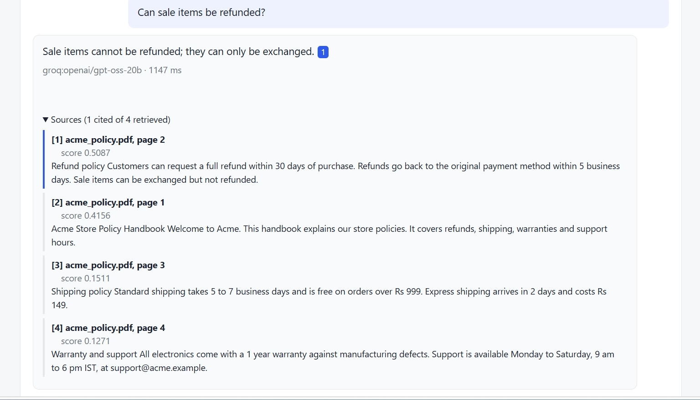
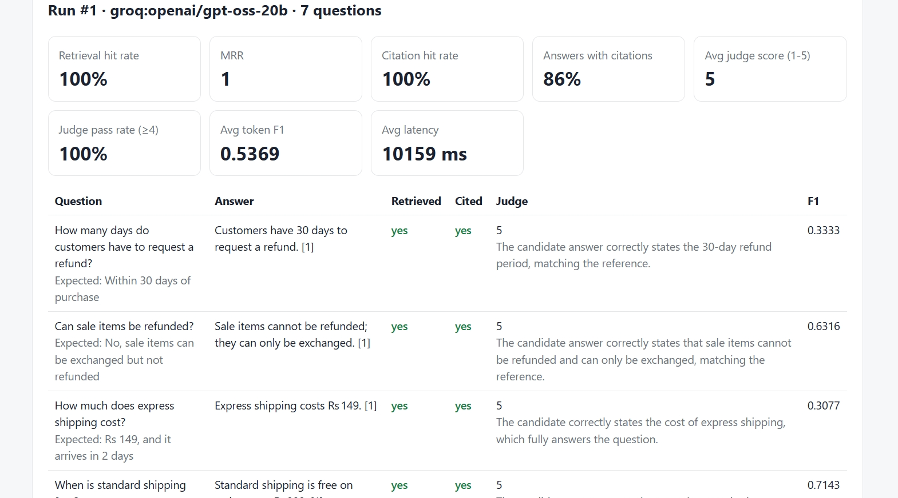
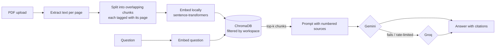

# 📄 Chat with Docs: a RAG platform with built-in evaluation

Upload PDFs, ask questions, and get answers that cite the exact page they came from.
It includes user accounts, separate workspaces, and an **evaluation page that measures how accurate the answers really are**.

Built with **FastAPI · ChromaDB · sentence-transformers · Gemini (Groq as backup) · JWT auth**.
It runs entirely on free tiers, and you can switch to Claude, or any other model, by changing one line in `.env`.


## Results

Evaluated on a 7-question test set (`sample_docs/acme_evals.json`), including one question whose answer is **not** in the document:

| Metric | Score |
|---|---|
| Retrieval hit rate | 100% |
| Citation hit rate | 100% |
| LLM-judge pass rate (≥4/5) | 100% |
| Correctly refused the unanswerable question | ✅ |



**What I learned:** the LLM judge was lenient. It gave 5/5 to an answer that left out part of the expected answer. That's why the app tracks several metrics instead of trusting one. The test set is small, and the next step is a larger, harder set on a real 30+ page document.
## Features

- **Answers with citations.** Every claim links to `[n]`, and you can expand it to see the file, page and the exact passage used.
- **Login and private workspaces.** JWT auth with bcrypt-hashed passwords. Every query is filtered by workspace, so users never see each other's data, and tests check this.
- **Evaluation page.** Run a set of test questions and get a scored report, saved so you can compare runs over time:

  | Metric | What it tells you |
  |---|---|
  | Retrieval hit rate / MRR | Did search find the right page, and how high was it ranked? |
  | Citation hit rate | Did the answer actually cite the right page? |
  | Answers with citations | Catches answers made up without using the sources |
  | LLM-judge score (1–5) | Is the answer correct compared to the expected answer? |
  | Token F1 | Free, deterministic word-overlap score |
  | Latency | How fast each answer was |

- **Model is a setting, not code.** Gemini is the main model, Groq takes over automatically if Gemini fails or hits its daily limit, and Claude or Ollama are one `.env` change away.
- **Free embeddings.** `all-MiniLM-L6-v2` runs locally, so there is no API cost.
- **22 tests that run offline.** They use a fake LLM and a fake embedder, so they need no keys and cost nothing.

## How it works



## Quick start

**1. Install** (Python 3.10+)

```bash
python -m venv .venv
# Windows: .venv\Scripts\activate     Mac/Linux: source .venv/bin/activate

# Optional but recommended: the CPU-only PyTorch build is much smaller than the default
pip install torch --index-url https://download.pytorch.org/whl/cpu

pip install -r requirements.txt
```

**2. Add your free API keys**

```bash
cp .env.example .env      # Windows: copy .env.example .env
```

Fill in `GEMINI_API_KEY` (from [Google AI Studio](https://aistudio.google.com/apikey)) and `GROQ_API_KEY` (from [Groq Console](https://console.groq.com/keys)), and set a long random `JWT_SECRET`.

**3. Run**

```bash
uvicorn app.main:app --reload
```

Open http://localhost:8000. The interactive API docs are at http://localhost:8000/docs.

**4. Try it with the sample files**

1. Create an account, then upload `sample_docs/acme_policy.pdf`. The first upload downloads the embedding model (about 90 MB), so it takes a minute.
2. Ask: *"Can sale items be refunded?"*
3. Open **Evaluation**, paste the contents of `sample_docs/acme_evals.json`, and click **Run evaluation**.

## Run the tests

```bash
pytest -q
```

## Switch to Claude later

```env
LLM_PROVIDER=claude
LLM_MODEL=claude-haiku-5-5
ANTHROPIC_API_KEY=sk-ant-...
```

That's the only change. Every provider implements the same `complete(system, user)` interface in `app/llm.py`.

## API

| Method | Endpoint | |
|---|---|---|
| POST | `/api/auth/register` · `/api/auth/login` | Get a JWT |
| GET | `/api/auth/me` | Current user |
| GET/POST/DELETE | `/api/workspaces[/{id}]` | Manage workspaces |
| GET/POST/DELETE | `/api/workspaces/{id}/documents[/{doc_id}]` | Upload, list and delete PDFs |
| POST | `/api/workspaces/{id}/chat` | Ask a question |
| GET/POST | `/api/workspaces/{id}/evals[/{run_id}]` | Run and view evaluations |

## Project structure

```
app/
  main.py          FastAPI app + UI
  config.py        every setting (read from .env)
  llm.py           Gemini / Groq / Claude / Ollama + automatic fallback
  embeddings.py    local sentence-transformers
  vectorstore.py   ChromaDB, scoped per workspace
  ingest.py        PDF → pages → chunks (keeps page numbers)
  rag.py           retrieve → prompt → cited answer
  evals.py         metrics + LLM judge
  auth.py          JWT + bcrypt + workspace ownership checks
  routers/         HTTP endpoints
  static/index.html  single-page UI (no build step)
tests/             offline tests with fake LLM + embedder
sample_docs/       demo PDF + eval set
```

## Ideas for what to add next

- Hybrid search (BM25 + vectors) and a reranker. Use the eval page to show it improves the scores.
- Background upload processing for large PDFs
- Streaming answers
- Docker + deployment to Render or Railway
- OCR for scanned PDFs
